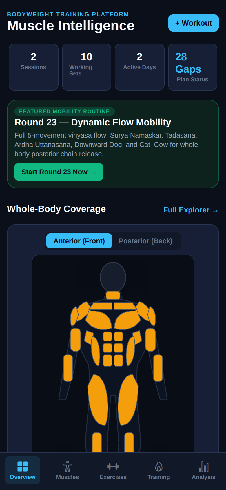
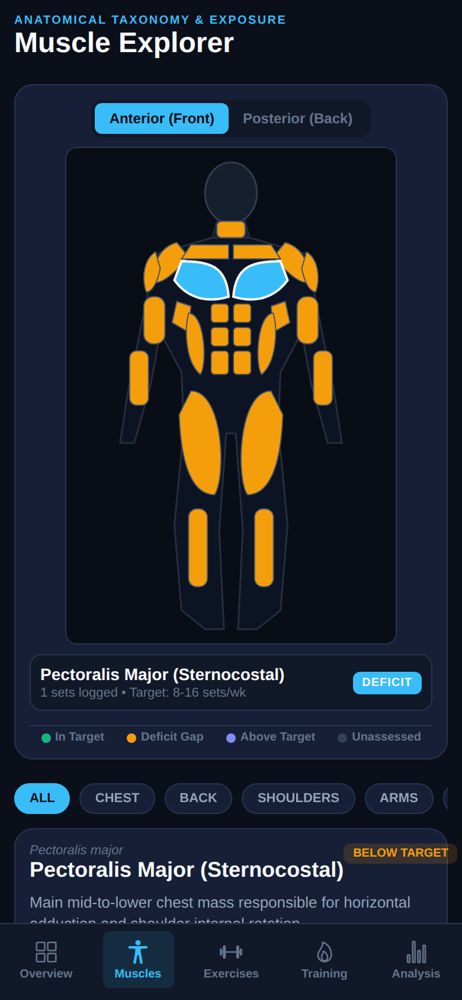
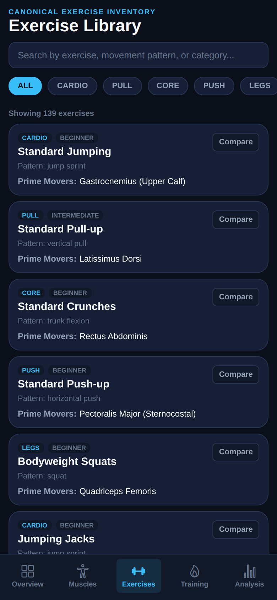
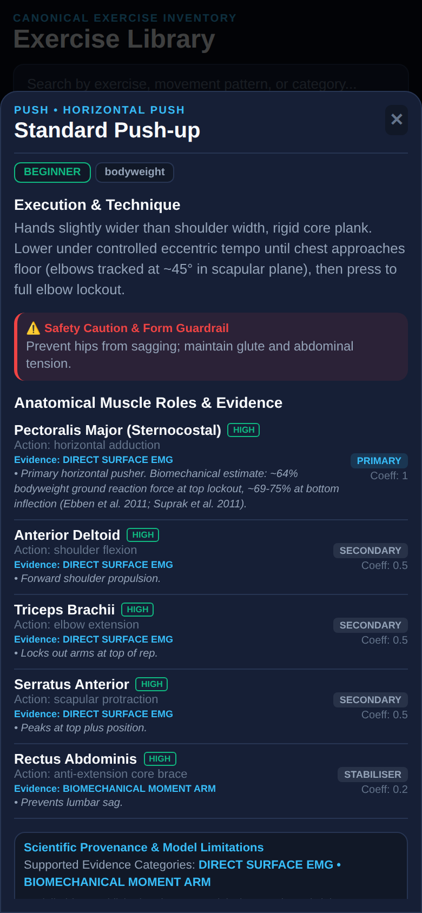
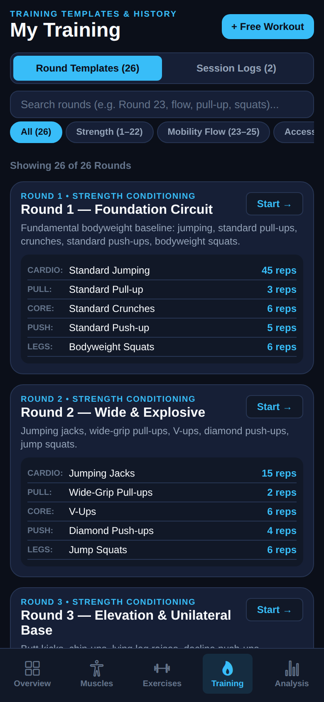
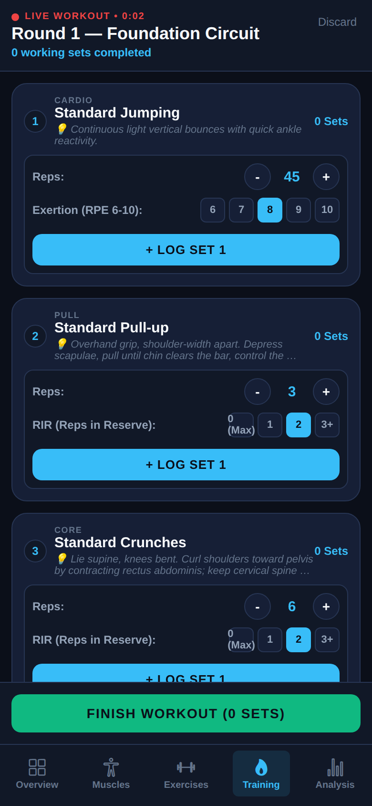
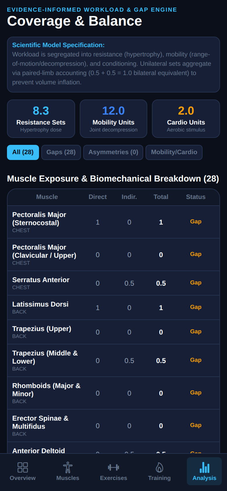

# Muscle Intelligence ⚡

> **A research-informed bodyweight training analysis, planning and optimisation platform**  
> *Next.js • React Native (Expo) • Supabase • PostgreSQL*

Muscle Intelligence turns a comprehensive bodyweight exercise library (22 original strength rounds, 3 mobility flows, and an accessory muscle-balance collection) and a user's logged training into an **explainable model** of muscular coverage, weekly training dose, exercise overlap, progression, and potential gaps.

---

## 📱 Mobile Application Gallery & Visual Showcase

All seven verified core mobile screens running on the dark navy/cyan visual theme:

| 1. Dashboard (Overview) | 2. Muscle Explorer (Anatomy) | 3. Exercise Library |
| :---: | :---: | :---: |
|  |  |  |
| *Whole-body coverage map, weekly metrics, featured mobility flows* | *Selectable front/back anatomy with canonical muscle highlight* | *Filtered by category, unilateral tags, and movement pattern* |

| 4. Exercise Detail & Biomechanics | 5. Training Routines (Rounds 1–26) | 6. Live Contextual Workout Logger |
| :---: | :---: | :---: |
|  |  |  |
| *Evidence citations, joint actions, and bodyweight load estimates* | *Foundation circuits, vinyasa mobility, and balancer collections* | *Contextual effort inputs (RIR / Stretch / RPE) & paired unilateral logging* |

| 7. Coverage & Balance Gap Analysis |
| :---: |
|  |
| *Workload segregation, single-limb asymmetry detection, and fractional accounting* |

---

## 📚 Product & Engineering Audits

The system specifications, audits, and scientific models are available in `/docs`:

1. **[Frontend Visual & Regression Audit](docs/audits/FRONTEND_VISUAL_AUDIT.md)**  
   *Inspection of the seven running mobile screens, SVG anatomy renderer fixes, vector icon migration, responsive layout bounds, and baseline calibration logic.*

2. **[Exposure Engine Corrections](docs/audits/EXPOSURE_ENGINE_CORRECTIONS.md)**  
   *Separation of resistance hypertrophy volume from mobility and conditioning, date interval windowing, technique qualification rules, and personalized muscle targets.*

3. **[Unilateral Accounting Specification](docs/audits/UNILATERAL_ACCOUNTING_SPEC.md)**  
   *Paired-limb volume aggregation ($0.5 + 0.5 = 1.0$), elimination of unilateral volume double-counting, and functional asymmetry monitoring.*

4. **[Database Integrity & RLS Security Review](docs/audits/RLS_SECURITY_REVIEW.md)**  
   *PostgreSQL check constraints for RIR (0.0–5.0), set and session ownership enforcement triggers, custom round exercise isolation, and scientific reviewer authorization.*

5. **[Multidimensional Exercise Comparison Model](docs/audits/EXERCISE_COMPARISON_MODEL.md)**  
   *5-dimensional kinematic and physiological scoring model replacing naive muscle overlap, with substitution feasibility classification.*

6. **[Validation Test Matrix](docs/audits/VALIDATION_TEST_MATRIX.md)**  
   *1,216 test executions across database integrity, calculation engine formulations, and canonical taxonomy referential checks.*

---

## 🏗 System Architecture & Repository Layout

The project is organised as a clean TypeScript monorepo where Web and Mobile share canonical exercise data, anatomy definitions, domain types, and calculation engines:

```
muscle-intelligence/
├── apps/
│   ├── mobile/               # React Native + Expo mobile application
│   └── web/                  # Next.js web application
├── packages/
│   ├── domain/               # Domain models, entities and types
│   ├── calculations/         # Deterministic exposure, RIR, comparison engine
│   ├── exercise-data/        # Canonical exercises (Rounds 1-26) & anatomy taxonomy
│   └── design-tokens/        # Shared color tokens, spacing, typography
├── supabase/
│   ├── migrations/           # PostgreSQL schema & RLS policies (Migrations 1–7)
│   └── seed.sql              # Idempotent seed data for canonical library
├── docs/                     # Full specifications & visual audit logs
│   ├── audits/               # 6 deep engineering audit reports
│   └── screenshots/          # 7 captured mobile screen artifacts
└── README.md
```

---

## 🚀 Quick Start (Mobile App)

### Prerequisites
- Node.js >= 18 (Node 20+ recommended)
- npm or pnpm

### Running the Mobile App
```bash
# Navigate to mobile app
cd apps/mobile

# Install dependencies
npm install

# Start the Expo development server
npx expo start --web --port 8081
```

Access the app in your browser at `http://localhost:8081` or scan the QR code via **Expo Go** on Android or iOS.

### Running Test Suites
```bash
# Run independent unit and integration tests (17 tests)
npm test

# Run referential integrity and scientific validation suite (1,199 tests)
npm run validate-imports
```

---

## 🔬 Scientific Core & Explainability Principle

Every training exposure score is calculated deterministically through the shared `@muscle-intelligence/calculations` engine:

$$\text{WeeklyExposure}[m] = \sum_{e \in \text{exercises}} \left( \text{hard\_sets}[e] \times \text{coefficient}[e, m] \right)$$

Scores are clearly labelled with their classification: `measured`, `user_reported`, `evidence_derived`, `modelled`, or `assumed`, strictly avoiding false precision.
