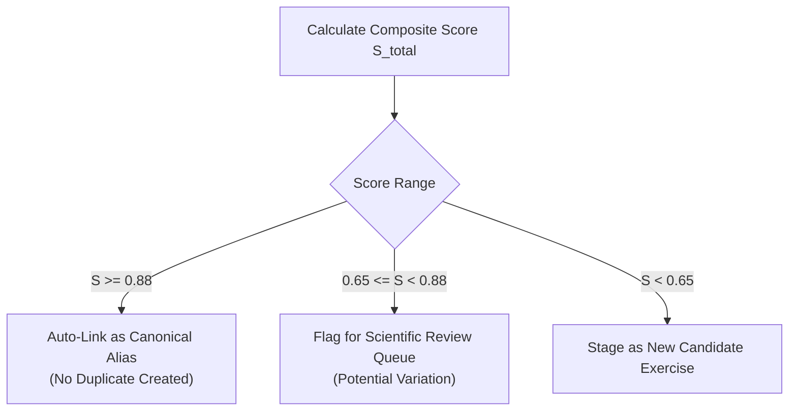

# Import & Normalisation Specification
**Muscle Intelligence — Data Ingestion Mappings, Conflict Resolution & Entity Matching**
*Specification Document: November 2026*

This document defines the deterministic rules for importing, normalising, deduplicating, and reconciling external exercise and biomechanics datasets into canonical Muscle Intelligence entities.

---

## 1. Canonical Field Mappings by External Source

### 1.1 Kinetic Exercises Database (`@kinetic-place/exercises-db`)

| Kinetic Field | Canonical Supabase Field | Normalisation / Transformation Rule |
|---|---|---|
| `id` | `staging_exercises.external_record_id` | Preserved verbatim as external identifier. |
| `name` | `exercises.name` | Normalized using Title Case; hyphens standardise to en-dashes or unified formatting (e.g. "Push-up" -> "Push-up"). |
| `bodyPart` | `exercises.primary_category` | Mapped via lookup table: `chest` -> `push`, `back` -> `pull`, `waist` -> `core`, `upper legs` / `lower legs` -> `legs`, `cardio` -> `cardio`. |
| `equipment` | `exercises.equipment` | Array transformation: `"body weight"` -> `["bodyweight"]`, `"pull-up bar"` -> `["pull_up_bar"]`. |
| `target` | `exercise_muscles.muscle_id` | Mapped to canonical muscle ID via `targetMuscleMap` (e.g., `"pectorals"` -> `'pectoralis_major_sternal'`, `role: 'primary'`). |
| `secondaryMuscles` | `exercise_muscles` (array) | Each item mapped to canonical muscle ID with `role: 'secondary'` and `coefficient: 0.5`. |
| `instructions` | `exercises.instructions` | Array of strings joined with newline separators. |

### 1.2 wger Exercise API (`/api/v2/exercise/`)

| wger Field | Canonical Supabase Field | Transformation Rule |
|---|---|---|
| `id` | `staging_exercises.external_record_id` | Preserved as integer string for attribution. |
| `name` | `exercise_aliases.alias` | Ingested into alias dictionary to enhance search queries. |
| `description` | `exercise_notes` | HTML tags stripped using regex `/<[^>]*>?/gm`. |
| `muscles` | `exercise_muscles` | wger muscle IDs mapped to canonical muscle IDs with `role: 'primary'`. |
| `muscles_secondary` | `exercise_muscles` | wger secondary IDs mapped with `role: 'secondary'`. |
| `equipment` | `exercises.equipment` | wger equipment IDs mapped to canonical equipment slugs. |

### 1.3 OpenAlex API (`api.openalex.org/works`)

| OpenAlex Field | Canonical `research_studies` Field | Transformation Rule |
|---|---|---|
| `id` | `openalex_id` | Full URI stripped to canonical ID (e.g., `https://openalex.org/W2165518427` -> `W2165518427`). |
| `doi` | `doi` | Normalized lowercase string: `https://doi.org/10.1519/jsc.0b013e3181e3826e` -> `10.1519/jsc.0b013e3181e3826e`. |
| `display_name` | `title` | Trimmed whitespace and escaped entities. |
| `authorships[].author.display_name` | `authors` | Extracted into text array. |
| `publication_year` | `publication_year` | Integer year. |
| `primary_location.source.display_name` | `journal` | Standard journal title. |
| `concepts` | `study_concepts` | Array of concepts filtered for score $\ge 0.5$. |
| `open_access.oa_url` | `open_access_url` | Direct URL to legal PDF. |

---

## 2. Equipment & Movement Pattern Normalisation

### 2.1 Equipment Taxonomy Mapping

```typescript
export const equipmentNormalisationMap: Record<string, string> = {
  'body weight': 'bodyweight',
  'bodyweight': 'bodyweight',
  'none': 'bodyweight',
  'calisthenics': 'bodyweight',
  'pull-up bar': 'pull_up_bar',
  'pull up bar': 'pull_up_bar',
  'chin-up bar': 'pull_up_bar',
  'parallel bars': 'dip_station',
  'dip bars': 'dip_station',
  'dip station': 'dip_station',
  'wall': 'wall',
  'staircase': 'stairs',
  'stairs': 'stairs',
  'box': 'box_bench',
  'bench': 'box_bench',
  'chair': 'box_bench',
  'towel': 'towel_strap',
  'rope': 'jump_rope',
  'jump rope': 'jump_rope',
};
```

### 2.2 Movement Pattern Heuristics

When importing unclassified movements, the normalisation engine assigns patterns using joint action and directionality tokens:

| Pattern Slug | Trigger Keywords & Tokens | Joint Kinetics |
|---|---|---|
| `vertical_pull` | `pull-up`, `chin-up`, `lat pulldown`, `climb` | Shoulder adduction / extension in coronal/sagittal plane with overhead start |
| `horizontal_pull` | `row`, `inverted row`, `australian pull-up`, `face pull` | Shoulder horizontal abduction and scapular retraction |
| `vertical_push` | `pike push-up`, `handstand push-up`, `overhead press` | Shoulder flexion / abduction with upward scapular rotation |
| `horizontal_push` | `push-up`, `pushup`, `dip`, `chest press` | Shoulder horizontal adduction and elbow extension |
| `squat` | `squat`, `pistol squat`, `sissy squat`, `duck walk` | Simultaneous bilateral knee and hip flexion with upright trunk |
| `lunge` | `lunge`, `split squat`, `step-up`, `cossack squat` | Asymmetric single-leg knee and hip flexion |
| `hip_hinge` | `glute bridge`, `hip thrust`, `nordic curl`, `good morning` | Dominant hip extension with minimal knee flexion excursion |
| `anti_extension` | `plank`, `ab wheel`, `hollow body`, `dead bug` | Isometric resistance against lumbar extension torque |
| `anti_rotation` | `side plank`, `bird dog`, `pallof press` | Isometric resistance against trunk rotational torque |
| `trunk_flexion` | `crunch`, `v-up`, `leg raise`, `toes-to-bar` | Dynamic shortening of rectus abdominis / lumbar flexion |

---

## 3. Deduplication & Entity Matching Algorithm

To resolve candidate exercises against canonical rounds, Muscle Intelligence uses a multi-tiered similarity score $S_{\text{total}} \in [0.0, 1.0]$:

$$S_{\text{total}} = 0.40 \times S_{\text{name}} + 0.30 \times S_{\text{pattern}} + 0.20 \times S_{\text{muscles}} + 0.10 \times S_{\text{equipment}}$$

Where:
1. $S_{\text{name}}$: Normalised Levenshtein edit distance combined with Jaro-Winkler prefix bonus on sanitized lowercase tokens.
2. $S_{\text{pattern}}$: Binary match on primary movement pattern ($1.0$ if identical, $0.0$ if conflicting).
3. $S_{\text{muscles}}$: Jaccard similarity index across target muscle sets:
   $$J(M_A, M_B) = \frac{|M_A \cap M_B|}{|M_A \cup M_B|}$$
4. $S_{\text{equipment}}$: Jaccard similarity on required equipment sets.

### Automated Decision Boundaries



---

## 4. Conflict Resolution Protocol

When multiple external datasets disagree on muscle involvement or classification (e.g., whether the serratus anterior is primary or secondary in a push-up):

1. **Hierarchy of Evidence Principle:**
   - Empirical EMG / kinematic measurement ($C_3, C_2$) **always overrides** unreferenced database classifications ($C_8$).
   - For example: If wger lists biceps brachii as primary in a standard pronated pull-up, but Youdas et al. (2010) demonstrates latissimus dorsi at $117\%$ MVC vs biceps brachii at $55\%$ MVC, the empirical study governs. Latissimus dorsi remains `primary (1.0)`, while biceps brachii is mapped as `secondary (0.5)`.
2. **Reviewer Override Immutability:**
   - Any manual human review decision stored in `exercise_muscles` with a valid `reviewed_by` UUID is **strictly immutable** to automated ingestion scripts.
   - Subsequent script executions log disagreements to `evidence_reviews` as informational notices without altering the approved record.
