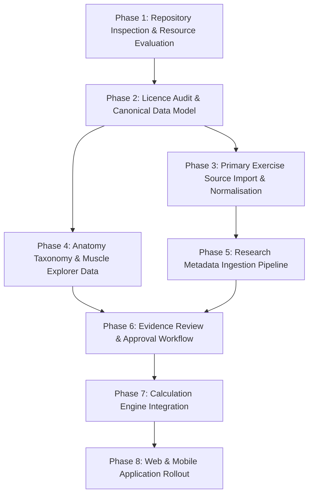

# Phased Integration Roadmap & Engineering Milestones
**Muscle Intelligence — Scientific Data & Platform Implementation Plan**
*Roadmap Version: 1.0 (November 2026)*

This roadmap details the sequential execution plan for building and integrating the open-source research and scientific data foundation of Muscle Intelligence across the monorepo, backend, web, and mobile clients.

---

## Roadmap Overview & Dependency Graph

---

## Phase Breakdown

### Phase 1: Repository Inspection & Resource Evaluation (CURRENT)
- **Objective:** Complete full architectural audit of existing assets, evaluate 18 candidate resources across exercise, anatomy, biomechanics, EMG, and bibliometric domains, and establish scientific evidence standards.
- **Key Deliverables:**
  - `docs/research/OPEN_SOURCE_RESOURCE_AUDIT.md` (18-resource evaluation matrix).
  - `docs/research/DATASET_CATALOGUE.md` (detailed study and dataset breakdown).
  - `docs/research/SCIENTIFIC_EVIDENCE_STANDARDS.md` (8 evidence categories and anti-confusion rules).
- **Exit Criteria:** All 18 resources catalogued with verified licenses, data structures, and strategic recommendations; repository gap analysis reported.

### Phase 2: Licence Audit & Canonical Data Model (CURRENT)
- **Objective:** Formulate legal boundary protections, author Supabase PostgreSQL migrations for all 5 domains, create idempotent seed scripts for the canonical 26-round library, and structure the modular ingestion package.
- **Key Deliverables:**
  - `docs/research/LICENCE_AUDIT.md` (commercial risk and copyleft boundary defense).
  - `docs/architecture/SUPABASE_SCHEMA.md` (complete schema and RLS policies).
  - `docs/architecture/RESEARCH_DATA_PIPELINE.md` & `IMPORT_AND_NORMALISATION.md`.
  - Supabase migrations (`20261110000001` through `20261110000006`).
  - Idempotent canonical seed (`supabase/seed.sql`).
  - Monorepo root setup and workspace linking.
  - Reproducible CLI validation test suite (`scripts/validate-imports.ts`).
- **Exit Criteria:** Database migrations apply cleanly; seed records load idempotently; validation tests pass 100%.

### Phase 3: Primary Exercise Source Import & Normalisation
- **Objective:** Ingest the primary external exercise database (Kinetic Exercises DB) via automated pipeline, run normalisation on names, equipment, and patterns, detect duplicates against canonical rounds, and stage records.
- **Key Deliverables:**
  - `packages/exercise-data/sources/kinetic/` parser and fetcher.
  - Normalisation engine mapping Kinetic targets to canonical muscle IDs.
  - CLI runner `scripts/import-exercises.ts --source=kinetic`.
  - Detailed import report with successfully imported, auto-linked, and queued records.
- **Exit Criteria:** Complete ingestion of ~850 exercises into staging tables with 0% unmapped equipment and automated deduplication against the 26 canonical rounds.

### Phase 4: Anatomy Taxonomy & Muscle Explorer Data
- **Objective:** Finalize the 28-muscle anatomical taxonomy with FMA identifiers, origins, insertions, and innervations; assemble front and back interactive 2D SVG vector maps.
- **Key Deliverables:**
  - `scripts/import-anatomy.ts` seeding full anatomical hierarchy.
  - Interactive SVG coordinates and layer IDs linked to `anatomical_structures`.
  - Shared `@muscle-intelligence/exercise-data` exports for web and mobile SVG components.
- **Exit Criteria:** Both web and mobile can render front and back anatomical bodies where selecting any muscle highlights direct/indirect exposure without 3D WebGL latency.

### Phase 5: Research Metadata Ingestion Pipeline
- **Objective:** Deploy automated programmatic fetchers for OpenAlex, PubMed Central Open Access subset, and Crossref to ingest peer-reviewed literature for calisthenic exercises.
- **Key Deliverables:**
  - `packages/exercise-data/sources/openalex/` client and parser.
  - Full-text PMC OA protocol extractor.
  - CLI runner `scripts/import-research.ts`.
  - Automated DOI resolution and bibtex generator.
- **Exit Criteria:** Automated retrieval of resistance training literature metadata; populates `research_studies`, `study_protocols`, and `study_findings`.

### Phase 6: Evidence Review & Approval Workflow
- **Objective:** Build the scientific review user interface and administrative queue where researchers review conflicting exercise classifications, assign confidence levels, and promote reviewed records to canonical tables.
- **Key Deliverables:**
  - Admin scientific review interface (Next.js admin route `/admin/research-review`).
  - Side-by-side conflict comparison viewer (e.g. wger vs Kinetic vs literature).
  - Approval mutation with audit trail (`reviewed_by`, `reviewed_at`, `notes`).
- **Exit Criteria:** Zero unreviewed records can enter production canonical tables; human approval workflow verified.

### Phase 7: Calculation Engine Integration
- **Objective:** Connect verified canonical database records and model parameters to `@muscle-intelligence/calculations`. Ensure mathematical rigor for weekly exposure, joint torque, mechanical work, power, and RIR.
- **Key Deliverables:**
  - Formulas validated with deterministic unit tests.
  - Complete output envelopes with model version, assumptions, source IDs, and confidence.
  - Integration with user session logs and target tracking.
- **Exit Criteria:** 100% test coverage on calculation formulas; all outputs include explainability metadata.

### Phase 8: Web & Mobile Application Rollout
- **Objective:** Expose the scientific data foundation across both client applications using shared TypeScript domain types and client queries.
- **Key Deliverables:**
  - Mobile: Interactive SVG Muscle Explorer, Exercise Comparison cards, Live Set Logger.
  - Web: Comprehensive analytical dashboard, Side-by-Side Biomechanics Comparator, Research Evidence Explorer.
- **Exit Criteria:** Shared logic running seamlessly on both Next.js and Expo without code duplication.
