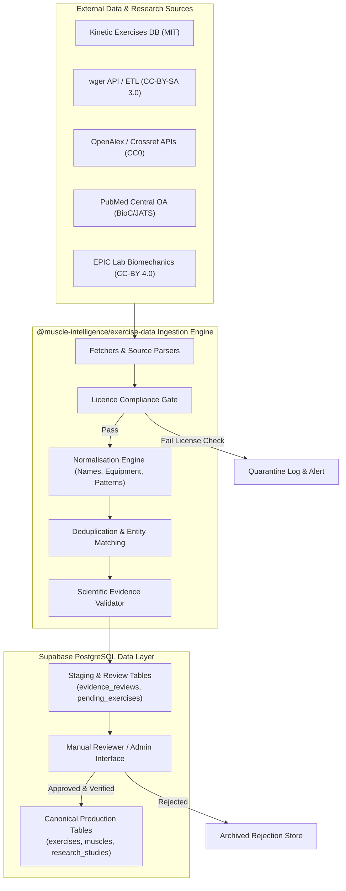

# Research Data Ingestion Pipeline Architecture
**Muscle Intelligence — Engineering Blueprint for Data Ingestion, Staging & Review**
*Architecture Document: November 2026*

This document defines the architecture, workflows, and automated gates of the Muscle Intelligence Research Data Pipeline. The pipeline ingests external exercise databases, scientific publications, and biomechanical datasets into Supabase PostgreSQL while enforcing strict scientific and licensing guardrails.

---

## 1. End-to-End Pipeline Architecture



---

## 2. Pipeline Execution Stages

### Stage 1: Fetching & Raw Extraction
- **Parsers:** Dedicated modular source parsers located in `packages/exercise-data/sources/`:
  - `kinetic-parser.ts`: Parses raw JSON exercise trees from `@kinetic-place/exercises-db`.
  - `wger-parser.ts`: Consumes read-only public REST API endpoints or static data snapshots.
  - `openalex-parser.ts`: Queries OpenAlex REST API with polite `mailto:` headers to fetch DOIs, publication years, concepts, and OA URLs.
  - `pmc-bioc-parser.ts`: Ingests open-access full-text methods and tables from PubMed Central.
- **Provenance Tagging:** Every extracted record is wrapped in an ingestion envelope:
  ```typescript
  interface RawIngestionEnvelope<T> {
    externalSourceId: string;
    originalRecordId: string;
    sourceUrl: string;
    license: string;
    importDate: string;
    rawPayload: T;
  }
  ```

### Stage 2: Automated Licence Compliance Gate
- Before processing any record, the pipeline runs automated license checks in `packages/exercise-data/licence-checks/`:
  1. Checks if the license is registered in `source_licenses`.
  2. Ensures commercial reuse is legally authorized (`is_commercial_allowed === true`).
  3. Validates that no copyleft viral constraints (such as AGPL-3.0 network clauses) penetrate production application bundles.
  4. Tags records with required downstream attribution text.

### Stage 3: Normalisation Engine
- Normalises raw strings, heterogeneous taxonomies, and units into canonical identifiers (`packages/exercise-data/normalisation/`):
  - **Exercise Names:** Strips leading/trailing punctuation, normalises hyphenation, resolves contractions (e.g. "Pull-up", "Pull Up", "pullup" -> `Pull-up`).
  - **Equipment Mapping:** Translates varying equipment labels into canonical Supabase equipment slugs (`bodyweight`, `pull_up_bar`, `dip_station`, `wall`, `box_bench`, `towel_strap`).
  - **Movement Patterns:** Maps freeform exercise types to the 15 canonical patterns (`vertical_pull`, `horizontal_push`, `squat`, `lunge`, etc.).
  - **Muscle Slug Resolution:** Resolves raw muscle strings to canonical muscle IDs using the 28-muscle anatomical taxonomy.

### Stage 4: Deduplication & Canonical Entity Resolution
- Evaluates candidate records against the existing canonical exercise catalog using multi-stage matching (`packages/exercise-data/deduplication/`):
  1. **Exact Slug Match:** Direct match against canonical exercise ID or alias dictionary.
  2. **Levenshtein Distance:** Normalised Levenshtein similarity on sanitized exercise titles.
  3. **Biomechanical Jaccard Similarity:** Compares movement pattern, target muscles, equipment, and kinetic chain flags.
- **Thresholds:**
  - $\text{Similarity} \ge 0.90$: High-probability match; automatically linked as an alias/variation of the existing canonical exercise.
  - $0.65 \le \text{Similarity} < 0.90$: Potential match or variation; flagged for manual scientific review.
  - $\text{Similarity} < 0.65$: Distinct candidate; processed as a novel candidate library exercise.

### Stage 5: Scientific Evidence & Schema Validation
- Validates the record against Zod schemas in `packages/exercise-data/validation/`:
  - Required fields present: instructions, difficulty, equipment, movement patterns.
  - Muscle mappings must explicitly state role (`primary`, `secondary`, `stabiliser`, `incidental`), joint action, evidence category, and confidence level ($0.0 - 1.0$).
  - Prevents false precision: flags records that attempt to assign unfounded numerical torque or force values without experimental sensor citations.

### Stage 6: Staging & Review Workflow
- **Rule:** Unreviewed external data is **NEVER** inserted directly into authoritative production tables.
- Candidate records are staged in PostgreSQL tables:
  - `evidence_reviews`
  - `staging_exercises`
- Scientific reviewers inspect the candidate mapping in the Review Interface:
  - Compares conflicting muscle classifications across sources.
  - Audits study methodology, population demographics, and limitations.
  - Approves, rejects, or adjusts coefficients.
  - **Immutability Guarantee:** Approved canonical records are locked. Future automated ingestion runs will never silently overwrite or downgrade a human-reviewed mapping.

---

## 3. Directory & Module Structure

```
packages/exercise-data/
├── package.json
├── tsconfig.json
├── src/
│   ├── index.ts                     # Public API exports
│   ├── muscles.ts                   # Canonical 28-muscle taxonomy
│   ├── exercises.ts                 # Authoritative 26-round canonical exercises
│   ├── rounds.ts                    # Round templates (1-22, 23-25, 26)
│   ├── sources/                     # Source extractors
│   │   ├── kinetic/
│   │   │   ├── parser.ts
│   │   │   └── types.ts
│   │   ├── wger/
│   │   │   ├── parser.ts
│   │   │   └── client.ts
│   │   └── openalex/
│   │       ├── parser.ts
│   │       └── client.ts
│   ├── normalisation/               # Normalisation rules
│   │   ├── exercise-normaliser.ts
│   │   ├── muscle-mapper.ts
│   │   ├── equipment-mapper.ts
│   │   └── units-normaliser.ts
│   ├── deduplication/               # Entity resolution
│   │   ├── string-similarity.ts
│   │   └── exercise-matcher.ts
│   ├── licence-checks/              # Legal compliance gates
│   │   └── licence-validator.ts
│   ├── validation/                  # Schema integrity
│   │   └── schemas.ts
│   └── importers/                   # Pipeline runners
│       ├── exercise-pipeline.ts
│       └── research-pipeline.ts
```

---

## 4. Operational Scripts & Automation

The pipeline is operated via reproducible CLI scripts in `/scripts`:
1. `npx tsx scripts/import-exercises.ts --source=kinetic`: Ingests and stages exercises from Kinetic DB.
2. `npx tsx scripts/import-anatomy.ts`: Validates and seeds anatomical taxonomy, muscle heads, and joint actions.
3. `npx tsx scripts/import-research.ts --query="bodyweight resistance training"`: Queries OpenAlex and PubMed Central for citations and methods.
4. `npx tsx scripts/validate-imports.ts`: Executes comprehensive validation suites across all staged and canonical records, generating an execution report.
