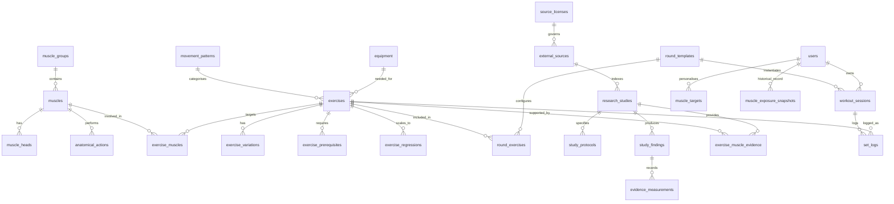

# Canonical Supabase PostgreSQL Schema Specification
**Muscle Intelligence — Database Architecture, Data Integrity & Security Policies**
*Schema Specification: November 2026*

This document provides the definitive data model for Muscle Intelligence. All tables, primary keys, foreign keys, constraints, indexes, and Row Level Security (RLS) policies are documented.

---

## 1. Entity-Relationship Overview

---

## 2. Detailed Table Specifications

### 2.1 Anatomy Domain

#### `muscle_groups`
Stores primary body regions.
- `id` (VARCHAR(50), PK): Unique slug (e.g., `'chest'`, `'back'`, `'shoulders'`).
- `name` (VARCHAR(100), NOT NULL): Human-readable name.
- `description` (TEXT): Clinical summary.
- `created_at` (TIMESTAMPTZ, DEFAULT NOW()).

#### `muscles`
Stores individual anatomical muscles or functional complexes.
- `id` (VARCHAR(100), PK): Unique slug (e.g., `'pectoralis_major_sternal'`, `'latissimus_dorsi'`).
- `muscle_group_id` (VARCHAR(50), FK -> `muscle_groups.id`): Parent region.
- `name` (VARCHAR(150), NOT NULL): Standard anatomical name.
- `latin_name` (VARCHAR(150)): Terminologia Anatomica designation.
- `fma_id` (VARCHAR(50)): Foundational Model of Anatomy identifier (e.g. `'FMA:9627'`).
- `description` (TEXT, NOT NULL): Functional role and anatomical description.
- `origin` (TEXT): Skeletal attachment origin.
- `insertion` (TEXT): Skeletal attachment insertion.
- `innervation` (TEXT): Innervating motor nerve.
- `laterality_supported` (BOOLEAN, DEFAULT TRUE): True if left/right sides operate independently.
- `default_weekly_target_min` (NUMERIC(4,1), DEFAULT 8.0): Baseline minimum direct working sets/week.
- `default_weekly_target_max` (NUMERIC(4,1), DEFAULT 16.0): Baseline maximum direct working sets/week.

#### `muscle_heads`
Represents distinct anatomical subdivisions, bellies, or fiber compartments.
- `id` (VARCHAR(100), PK): Slug (e.g. `'triceps_long_head'`, `'biceps_short_head'`).
- `muscle_id` (VARCHAR(100), FK -> `muscles.id`): Parent muscle.
- `name` (VARCHAR(150), NOT NULL): Head name.
- `fiber_orientation` (VARCHAR(100)): Line of action description.

#### `anatomical_actions`
Catalogues primary biomechanical joint actions produced by each muscle.
- `id` (UUID, PK, DEFAULT gen_random_uuid()).
- `muscle_id` (VARCHAR(100), FK -> `muscles.id`).
- `joint_action` (VARCHAR(100), NOT NULL): e.g. `'shoulder_horizontal_adduction'`, `'knee_flexion'`.
- `leverage_advantage` (VARCHAR(50)): e.g. `'primary_agonist'`, `'synergist'`.

#### `anatomical_structures`
Hierarchical tree for SVG/3D spatial geometry mapping.
- `id` (VARCHAR(100), PK).
- `muscle_id` (VARCHAR(100), FK -> `muscles.id`).
- `svg_element_id_front` (VARCHAR(100)): ID in front-view vector SVG.
- `svg_element_id_back` (VARCHAR(100)): ID in rear-view vector SVG.
- `mesh_identifier_3d` (VARCHAR(100)): Associated Z-Anatomy 3D polygon mesh ID.

---

### 2.2 Exercise Catalogue Domain

#### `movement_patterns`
- `id` (VARCHAR(50), PK): e.g. `'vertical_pull'`, `'horizontal_push'`, `'squat'`, `'lunge'`.
- `name` (VARCHAR(100), NOT NULL).
- `description` (TEXT).

#### `equipment`
- `id` (VARCHAR(50), PK): e.g. `'bodyweight'`, `'pull_up_bar'`, `'dip_station'`, `'wall'`.
- `name` (VARCHAR(100), NOT NULL).
- `is_minimal_calisthenics` (BOOLEAN, DEFAULT TRUE).

#### `exercises`
Canonical library of bodyweight movements and core variations.
- `id` (VARCHAR(100), PK): Unique canonical identifier.
- `name` (VARCHAR(150), NOT NULL): Standard title.
- `primary_category` (VARCHAR(50), NOT NULL): `'cardio' | 'pull' | 'core' | 'push' | 'legs' | 'mobility' | 'accessory'`.
- `difficulty` (VARCHAR(50), NOT NULL): `'beginner' | 'intermediate' | 'advanced' | 'elite'`.
- `default_unit` (VARCHAR(20), NOT NULL): `'reps' | 'seconds' | 'meters' | 'flights'`.
- `unilateral` (BOOLEAN, NOT NULL DEFAULT FALSE): Single-limb execution.
- `instructions` (TEXT, NOT NULL): Execution coaching cues.
- `safety_cautions` (TEXT): Joint safety alerts and contraindications.
- `is_user_custom` (BOOLEAN, DEFAULT FALSE).
- `created_by` (UUID, FK -> `auth.users`, NULL for canonical).
- `created_at` (TIMESTAMPTZ, DEFAULT NOW()).

#### `exercise_muscles`
Authoritative mapping between exercises and participating muscles.
- `id` (UUID, PK, DEFAULT gen_random_uuid()).
- `exercise_id` (VARCHAR(100), FK -> `exercises.id`, ON DELETE CASCADE).
- `muscle_id` (VARCHAR(100), FK -> `muscles.id`, ON DELETE CASCADE).
- `muscle_head_id` (VARCHAR(100), FK -> `muscle_heads.id`, NULLABLE).
- `role` (VARCHAR(20), NOT NULL): `'primary' | 'secondary' | 'stabiliser' | 'incidental'`.
- `coefficient` (NUMERIC(3,2), NOT NULL): Deterministic bookkeeping weight ($1.0, 0.5, 0.2, 0.0$).
- `joint_action` (VARCHAR(100), NOT NULL): Biomechanical action at the joint.
- `evidence_category` (VARCHAR(50), NOT NULL): Matches 1 of the 8 scientific evidence categories.
- `confidence` (NUMERIC(3,2), NOT NULL): Confidence score ($0.0 - 1.0$).
- `notes` (TEXT): Biomechanical commentary and limitations.
- `reviewed_by` (UUID, FK -> `auth.users`): Reviewer confirming mapping.
- `reviewed_at` (TIMESTAMPTZ).
- CONSTRAINT `uq_exercise_muscle` UNIQUE (`exercise_id`, `muscle_id`, `muscle_head_id`).

#### `exercise_variations`, `exercise_prerequisites`, `exercise_regressions`
Relational joins handling the regression and progression tree.

---

### 2.3 Research & Evidence Domain

#### `source_licenses`
- `id` (VARCHAR(50), PK): e.g. `'MIT'`, `'Apache-2.0'`, `'CC-BY-4.0'`, `'CC-BY-SA-3.0'`.
- `full_name` (VARCHAR(150), NOT NULL).
- `is_commercial_allowed` (BOOLEAN, NOT NULL).
- `requires_share_alike` (BOOLEAN, NOT NULL).
- `license_url` (TEXT).

#### `external_sources`
Tracks origin repository or database.
- `id` (VARCHAR(50), PK): e.g. `'kinetic'`, `'wger'`, `'openalex'`, `'pubmed'`, `'epic_lab'`.
- `license_id` (VARCHAR(50), FK -> `source_licenses.id`).
- `name` (VARCHAR(150), NOT NULL).
- `url` (TEXT NOT NULL).
- `attribution_text` (TEXT NOT NULL).

#### `research_studies`
Canonical bibliographic records for resistance training science.
- `id` (UUID, PK, DEFAULT gen_random_uuid()).
- `external_source_id` (VARCHAR(50), FK -> `external_sources.id`).
- `doi` (VARCHAR(150), UNIQUE): Normalized DOI.
- `pmid` (VARCHAR(50)): PubMed identifier.
- `openalex_id` (VARCHAR(100)): Canonical OpenAlex entity ID.
- `title` (TEXT, NOT NULL).
- `authors` (TEXT[], NOT NULL).
- `publication_year` (INTEGER, NOT NULL).
- `journal` (VARCHAR(200)).
- `abstract` (TEXT).
- `study_type` (VARCHAR(100)): e.g. `'randomized_controlled_trial'`, `'cross_sectional_emg'`, `'biomechanical_simulation'`.
- `open_access_url` (TEXT).
- `is_peer_reviewed` (BOOLEAN, DEFAULT TRUE).
- `evidence_category` (VARCHAR(50), NOT NULL).
- `created_at` (TIMESTAMPTZ, DEFAULT NOW()).

#### `study_protocols` & `study_findings`
Captures granular experimental protocols, subject cohorts, electrode placements, and statistical outcomes.

#### `exercise_muscle_evidence`
Direct association linking canonical `exercise_muscles` mappings to one or more `research_studies`.
- `id` (UUID, PK, DEFAULT gen_random_uuid()).
- `exercise_muscle_id` (UUID, FK -> `exercise_muscles.id`, ON DELETE CASCADE).
- `study_id` (UUID, FK -> `research_studies.id`, ON DELETE CASCADE).
- `finding_summary` (TEXT, NOT NULL).
- `reported_metric` (VARCHAR(100)): e.g. `'mean_emg_mvc_percent'`, `'peak_knee_extensor_torque'`.
- `reported_value` (VARCHAR(100)): e.g. `'78.4 +/- 6.2 %'`, `'142 Nm'`.
- `confidence_score` (NUMERIC(3,2), NOT NULL).
- `limitations` (TEXT): Documented methodological confounds.

#### `evidence_reviews`
Staging table for human scientific review of candidate imports.
- `id` (UUID, PK, DEFAULT gen_random_uuid()).
- `external_source_id` (VARCHAR(50), FK -> `external_sources.id`).
- `original_record_id` (VARCHAR(150), NOT NULL).
- `candidate_exercise_name` (VARCHAR(150), NOT NULL).
- `mapped_canonical_id` (VARCHAR(100), FK -> `exercises.id`, NULLABLE).
- `status` (VARCHAR(50), DEFAULT 'pending'): `'pending' | 'approved' | 'rejected' | 'modified'`.
- `review_notes` (TEXT).
- `reviewer_id` (UUID, FK -> `auth.users`).
- `created_at` (TIMESTAMPTZ, DEFAULT NOW()).
- `resolved_at` (TIMESTAMPTZ).

---

### 2.4 Calculation Engine Domain

#### `model_versions`
- `id` (VARCHAR(50), PK): e.g. `'weekly_exposure_v1.0'`, `'joint_torque_v1.0'`.
- `name` (VARCHAR(150), NOT NULL).
- `formula_definition` (TEXT, NOT NULL): Mathematical LaTeX definition.
- `is_active` (BOOLEAN, DEFAULT TRUE).
- `created_at` (TIMESTAMPTZ, DEFAULT NOW()).

#### `model_parameters`
Configurable coefficients and bounds.
- `id` (UUID, PK, DEFAULT gen_random_uuid()).
- `model_version_id` (VARCHAR(50), FK -> `model_versions.id`).
- `parameter_key` (VARCHAR(100), NOT NULL): e.g. `'primary_mover_coefficient'`, `'synergist_coefficient'`.
- `parameter_value` (NUMERIC(6,3), NOT NULL).
- `description` (TEXT).

#### `model_outputs` & `model_validation`
Stores historical execution audits, input parameters, confidence scores, and regression test benchmarks.

---

### 2.5 User Training Domain

#### `round_templates`
Houses the 26 canonical workout rounds (reusable templates).
- `id` (VARCHAR(50), PK): e.g. `'round_01'`, `'round_26'`.
- `round_number` (INTEGER, NOT NULL).
- `name` (VARCHAR(150), NOT NULL).
- `type` (VARCHAR(50), NOT NULL): `'strength_conditioning' | 'mobility' | 'accessory_balance'`.
- `description` (TEXT).
- `is_canonical` (BOOLEAN, DEFAULT TRUE).
- `created_by` (UUID, FK -> `auth.users`, NULL for canonical).

#### `round_exercises`
- `id` (UUID, PK, DEFAULT gen_random_uuid()).
- `round_template_id` (VARCHAR(50), FK -> `round_templates.id`, ON DELETE CASCADE).
- `exercise_id` (VARCHAR(100), FK -> `exercises.id`).
- `sequence` (INTEGER, NOT NULL).
- `default_value` (NUMERIC(6,2), NOT NULL): Target reps or hold duration.
- `unit` (VARCHAR(20), NOT NULL): `'reps' | 'seconds' | 'meters' | 'flights'`.
- `side_rule` (VARCHAR(30), DEFAULT 'bilateral'): `'bilateral' | 'each_side' | 'alternating'`.

#### `workout_sessions`
- `id` (UUID, PK, DEFAULT gen_random_uuid()).
- `user_id` (UUID, NOT NULL, FK -> `auth.users`, ON DELETE CASCADE).
- `round_template_id` (VARCHAR(50), FK -> `round_templates.id`, NULLABLE).
- `name` (VARCHAR(150), NOT NULL).
- `started_at` (TIMESTAMPTZ, NOT NULL).
- `ended_at` (TIMESTAMPTZ).
- `duration_seconds` (INTEGER).
- `notes` (TEXT).
- `completed` (BOOLEAN, DEFAULT FALSE).

#### `set_logs`
- `id` (UUID, PK, DEFAULT gen_random_uuid()).
- `session_id` (UUID, NOT NULL, FK -> `workout_sessions.id`, ON DELETE CASCADE).
- `user_id` (UUID, NOT NULL, FK -> `auth.users`, ON DELETE CASCADE).
- `exercise_id` (VARCHAR(100), NOT NULL, FK -> `exercises.id`).
- `set_number` (INTEGER, NOT NULL).
- `reps` (INTEGER).
- `hold_seconds` (NUMERIC(5,1)).
- `side` (VARCHAR(20), DEFAULT 'bilateral'): `'bilateral' | 'left' | 'right'`.
- `rir` (NUMERIC(3,1)): Repetitions in Reserve ($0.0 - 5.0$).
- `rpe` (NUMERIC(3,1)): Rating of Perceived Exertion ($1.0 - 10.0$).
- `technique_quality` (VARCHAR(30), DEFAULT 'good'): `'good' | 'acceptable' | 'degraded'`.
- `rest_seconds` (INTEGER).
- `completed_at` (TIMESTAMPTZ, DEFAULT NOW()).

---

## 3. Row Level Security (RLS) Architecture

| Domain | Table Type | Anonymous Users | Authenticated Users | Admin / Scientific Reviewers |
|---|---|---|---|---|
| **Anatomy** | Reference | `SELECT` | `SELECT` | `ALL` |
| **Exercise Catalogue** | Reference | `SELECT` | `SELECT` (plus `ALL` on own custom exercises) | `ALL` |
| **Research & Evidence** | Reference & Staging | `SELECT` (Canonical only) | `SELECT` (Canonical only) | `ALL` |
| **Calculation Engine** | Reference | `SELECT` | `SELECT` | `ALL` |
| **User Training** | User Data | `NONE` | `SELECT, INSERT, UPDATE, DELETE` (strictly filtered by `auth.uid() = user_id`) | `ALL` (or compliance-audited access) |
